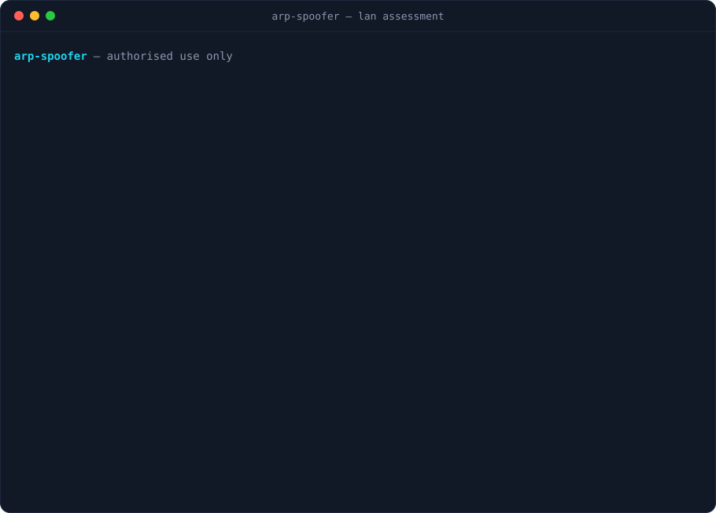

[](https://github.com/grimh3xx/arp-spoofer/actions)
[](LICENSE)


**A LAN man-in-the-middle & spoofing toolkit in Rust, for authorised internal network
assessments.** It bundles the layer-2 techniques a tester reaches for on an engagement —
ARP host discovery, ARP-spoof MITM, MAC spoofing, and LLMNR/NBT-NS/mDNS poisoning — behind
one tidy CLI that **cleans up after itself**: ARP caches are healed on exit and MAC changes
are restorable.

<p align="center"></p>

> ## ⚠️ Authorised use only
> This is an offensive tool. ARP spoofing, name-resolution poisoning and MAC spoofing are
> intrusive and disruptive. Run it **only** on networks you own or have **explicit written
> permission** to test. Using it against networks or hosts without authorisation is illegal
> in most jurisdictions. You are responsible for how you use it.

## Commands

| Command | What it does |
|---|---|
| `scan` | ARP-sweeps the interface's subnet and lists live hosts (IP → MAC). `--json` for machine output. |
| `arp` | ARP-spoofs a MITM between a `--target` and the `--gateway` (or `--all` discovered hosts), re-poisoning on an interval. On `Ctrl+C` it broadcasts the real mappings back so **all ARP caches are restored**. |
| `mac` | Sets a specific MAC, a random locally-administered one (`--random`), or restores the pre-spoof MAC (`--restore`). The original is saved automatically on the first change. |
| `respond` | Answers `LLMNR`/`NBT-NS`/`mDNS` queries with this host's IP — the Responder technique for coercing authentication. `--analyze` watches passively. |
| `capture` | HTTP (80) + SMB (445) listeners that issue an NTLM challenge and record the **NetNTLMv1/v2 response in hashcat format**. Pair it with `respond`. |
| `dnsspoof` | While MITM, forges A-record replies for passing DNS queries — all names or a `--domain` filter — pointing at a chosen IP. |
| `dhcp` | Rogue DHCP server handing clients this host as gateway + DNS, or `--starve` to flood the real server's pool. |
| `mitm6` | **Experimental** IPv6 DNS takeover: rogue Router Advertisements + DHCPv6 replies pointing DNS at this host. |
| `sniff` | Passively extracts cleartext credentials (HTTP Basic/form, FTP) from traffic. |
| `detect` | **Defensive**: watches the wire for ARP poisoning, duplicate gateway MACs, rogue DHCP servers and active name-responders. |

Capture/sniff/detect/dns/dhcp take `--log <file>` to append findings as JSONL (timestamped,
sourced) for an engagement artifact. Every write-type action is reversible, and nothing is
persisted beyond a single saved MAC in the temp dir for `--restore`.

### Maturity

`scan`, `arp`, `mac`, `respond`, `capture` (HTTP), `dnsspoof`, `sniff` and `detect` are the
solid core; the NTLMSSP and name-resolution parsers are unit-tested in CI. **SMB capture and
`mitm6` are best-effort/experimental** — they build well-formed packets but have not been
validated against live clients. Treat them as starting points, not finished exploits.

## Build

Needs the [Rust toolchain](https://rustup.rs). On Linux:

```bash
cargo build --release
```

The binary opens raw (`AF_PACKET`) sockets and binds privileged ports, so it needs
`CAP_NET_RAW`/`CAP_NET_BIND_SERVICE` — run it with `sudo`, or grant caps:

```bash
sudo setcap cap_net_raw,cap_net_admin,cap_net_bind_service+eip ./target/release/arp-spoofer
```

## Usage

```bash
# discover hosts
sudo ./arp-spoofer scan -i eth0

# MITM a host and the gateway (Ctrl+C restores both caches)
sudo sysctl -w net.ipv4.ip_forward=1          # relay traffic through you
sudo ./arp-spoofer arp -i eth0 -t 192.168.1.23 -g 192.168.1.1

# MAC spoofing
sudo ./arp-spoofer mac -i eth0 --random
sudo ./arp-spoofer mac -i eth0 --restore

# name-resolution poisoning (or watch passively with --analyze)
sudo ./arp-spoofer respond -i eth0
sudo ./arp-spoofer respond -i eth0 --analyze

# coerce + capture NetNTLM hashes (run alongside respond) -> hashcat -m 5600
sudo ./arp-spoofer capture --log loot.jsonl

# DNS spoofing while MITM
sudo ./arp-spoofer dnsspoof -i eth0 --spoof 192.168.1.50 --domain intranet

# rogue DHCP / pool starvation
sudo ./arp-spoofer dhcp -i eth0
sudo ./arp-spoofer dhcp -i eth0 --starve

# defensive: detect spoofing on the wire
sudo ./arp-spoofer detect -i eth0 --log alerts.jsonl
```

## Design

- **Packet work** uses [`pnet`](https://crates.io/crates/pnet) for layer-2 ARP framing and
  `socket2` for the responder's UDP/multicast listeners — no libpcap dependency on Linux.
- **Cleanup is first-class**: the `arp` MITM heals both caches on exit, and `mac` saves the
  original address before the first change so `--restore` always works.
- **`respond --analyze`** is a safe, non-intrusive mode for mapping which names clients ask
  for before deciding whether to answer.
- Parser logic (LLMNR/NBT-NS decoding and reply building) is covered by unit tests that run
  in CI without needing root.

### Out of scope (on purpose)

This is a coherent layer-2/LAN tool. GPS spoofing, e-mail-header spoofing and browser
User-Agent spoofing are unrelated domains and are intentionally left out rather than bolted
on.

## License

MIT
